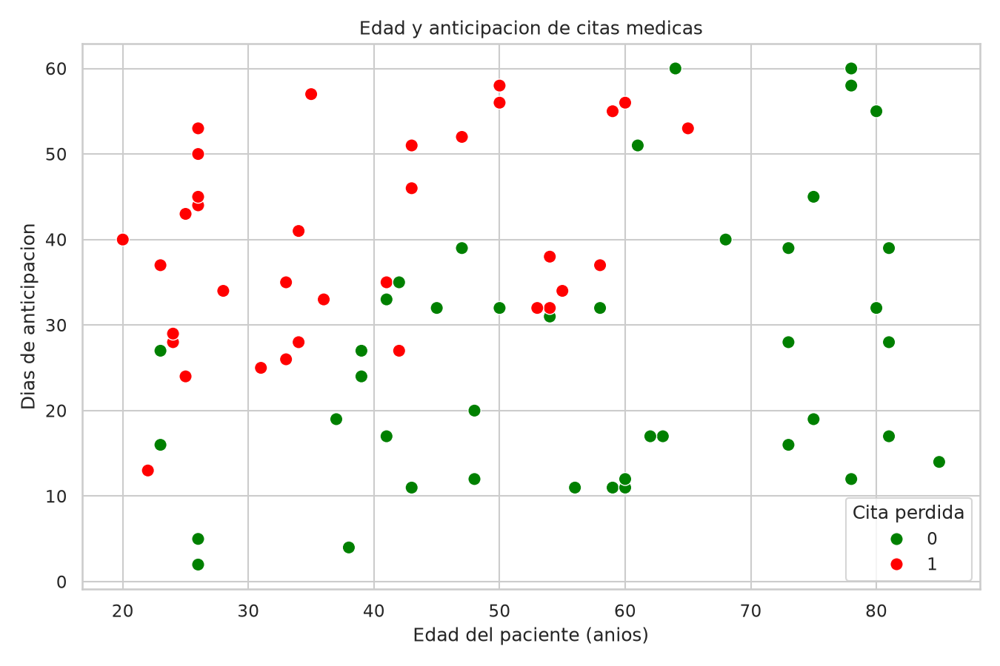
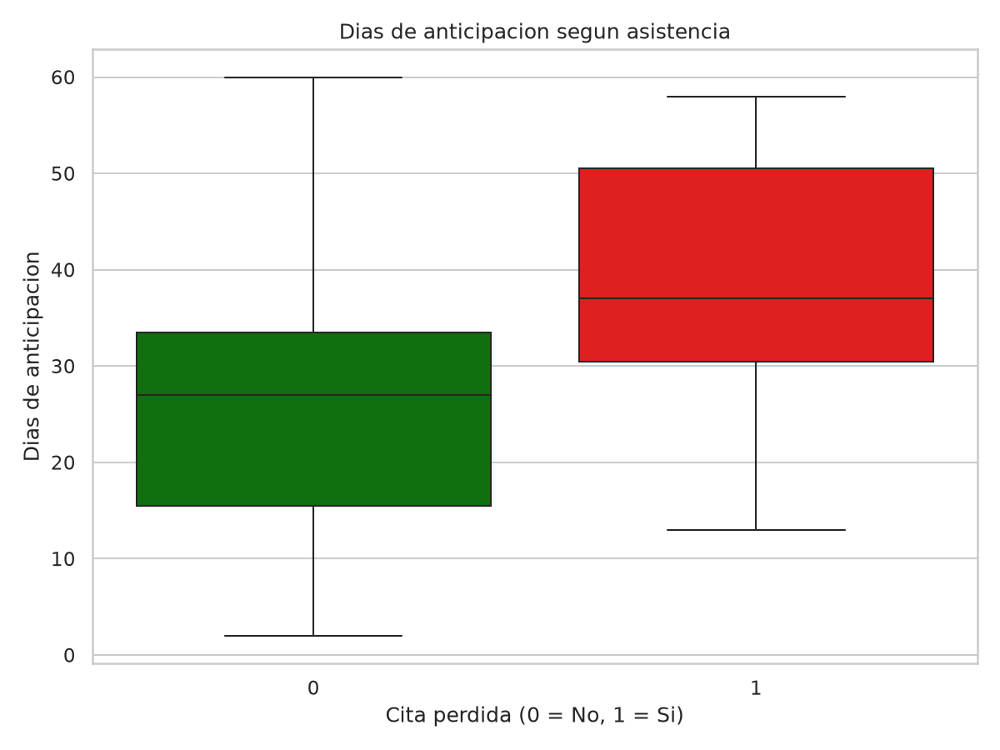
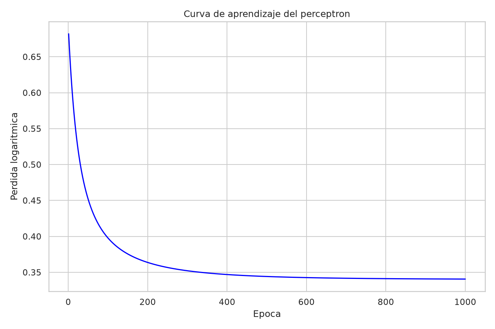
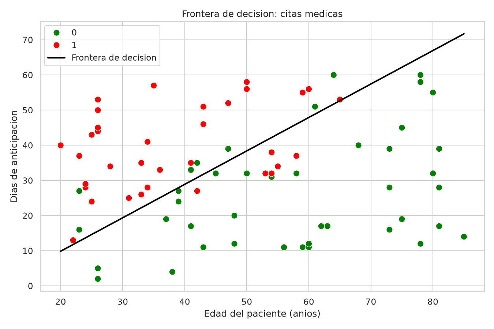

# Segundo Parcial - Inteligencia Artificial

**Estudiante:** Gustavo Adolfo Piedrahita López  
**Grupo:** 08 - Individual  
**Docente:** Jhon James Cano Sánchez  
**Fecha:** 26 de octubre de 2026

## 1. Descripción del problema

Se construyó un modelo de clasificación binaria para estimar la probabilidad de inasistencia a citas médicas en Cartago, Valle del Cauca.

Variables de entrada:
- edad_anios: edad del paciente.
- dias_anticipacion: días entre la programación y la cita.

Variable objetivo:
- cita_perdida: 1 si el paciente no asistió; 0 si asistió.

Se utilizaron Pandas para la limpieza, Seaborn para las visualizaciones y NumPy para implementar un perceptrón desde cero.

## 2. Entorno de ejecución

Tecnologías: Python 3.12, Docker, NumPy, Pandas, Matplotlib y Seaborn.

Para reproducir el proyecto:

```bash
docker compose up -d --build
docker exec parcial2_ia python src/parcial2.py
```

Para ingresar al contenedor:

```bash
docker exec -it parcial2_ia bash
```

Para detenerlo:

```bash
docker compose down
```

El programa genera el archivo limpio en `data/` y cuatro gráficos en `graficos/`.

## 3. Inspección inicial

El archivo original contiene 84 filas y 5 columnas.

Se identificaron:
- 4 filas duplicadas.
- 3 valores faltantes en dias_anticipacion.
- Una edad imposible de 516 años.
- Diferentes escrituras de las especialidades.

La columna dias_anticipacion aparece como float64, aunque representa días enteros, porque contiene valores NaN. Pandas utiliza un tipo que permite representar esos faltantes. La edad aparece como int64 y la variable objetivo también.

Distribución original:
- Clase 0: 45 registros.
- Clase 1: 39 registros.

## 4. Limpieza de datos

### Problema 1: Duplicados

Detección: `df.duplicated().sum()` identificó 4 filas exactamente repetidas.

Decisión: eliminarlas con `drop_duplicates()`.

Justificación: evitan contar dos veces la misma observación y distorsionar el entrenamiento.

### Problema 2: Valores faltantes

Detección: `df.isnull().sum()` identificó 3 valores faltantes en dias_anticipacion.

Decisión: imputarlos utilizando la mediana de los registros válidos, equivalente a 32 días.

Justificación: permite conservar los registros y es una medida robusta frente a valores extremos.

### Problema 3: Edad imposible

Detección: el registro P071 contenía una edad de 516 años.

Decisión: eliminar el registro.

Justificación: es una edad imposible y no tenemos información suficiente para corregirla de manera confiable.

### Problema 4: Categorías inconsistentes

Detección: `value_counts()` mostró variantes como OPTOMETRÍA, ginecología y especialidades con espacios adicionales.

Decisión: aplicar `str.strip()`, `str.lower()` y `str.capitalize()`.

Justificación: unifica categorías que representan la misma especialidad.

### Resultados de la limpieza

- Filas originales: 84.
- Filas finales: 79.
- Filas eliminadas: 5.
- Clase 0: 44 registros.
- Clase 1: 35 registros.
- Valores nulos restantes: 0.

Archivo generado: `data/grupo_08_limpio.csv`.

### Valor más sospechoso

El valor de 516 años fue el más sospechoso.

Media de edad antes de limpiar: 53.89 años.  
Media de edad después de limpiar: 48.90 años.

Sin corregirlo, ese valor extremo habría alterado la media y la desviación estándar de la variable edad, comprimiendo la escala de las edades normales y afectando los gradientes y pesos del perceptrón.

## 5. Visualizaciones

### Gráfico 1: Dispersión



Representa edad y días de anticipación, diferenciando las citas perdidas y las asistidas. Permite observar cómo se distribuyen las dos clases y el grado de superposición entre ellas.

### Gráfico 2: Comparación de clases



Los pacientes que asistieron tenían una anticipación promedio de 26.57 días y los que faltaron de 39.31 días.

La diferencia fue de 12.75 días.

Las medianas respectivas fueron 27 y 37 días.

Se observa una asociación entre una mayor anticipación y la inasistencia, sin que esto demuestre causalidad.

## 6. Perceptrón implementado desde cero

El modelo fue desarrollado únicamente con NumPy, sin utilizar Scikit-Learn.

Se implementaron:
- Estandarización de las dos variables.
- Función sigmoide.
- Predicción de probabilidades.
- Pérdida logarítmica.
- Cálculo de exactitud.
- Descenso del gradiente.
- Entrenamiento durante 1000 épocas.

Se utilizó una tasa de aprendizaje de 0.1.

Resultados:

| Indicador | Valor |
|---|---:|
| Peso inicial w1 | 0 |
| Peso inicial w2 | 0 |
| Sesgo inicial | 0 |
| Peso final w1 | -2.459053 |
| Peso final w2 | 2.057850 |
| Sesgo final | -0.707412 |
| Pérdida inicial | 0.693147 |
| Pérdida final | 0.340566 |
| Exactitud de entrenamiento | 83.54 % |
| Registros correctos | 66 |
| Registros incorrectos | 13 |

### Curva de aprendizaje



La pérdida disminuyó de 0.693147 a 0.340566, evidenciando que el algoritmo optimizó sus parámetros durante el entrenamiento.

### Frontera de decisión



La línea representa el umbral de probabilidad 0.5, separando las predicciones de asistencia e inasistencia en unidades originales.

## 7. Interpretación de resultados

### Pregunta 1. ¿Qué significan los signos de los pesos?

El peso w1 = -2.459053 indica que, manteniendo constante la anticipación, una mayor edad disminuye la probabilidad estimada de faltar a la cita.

El peso w2 = +2.057850 indica que una mayor anticipación aumenta la probabilidad estimada de inasistencia, manteniendo constante la edad.

En los datos de Cartago la relación con la anticipación es coherente con los promedios observados: 39.31 días en citas perdidas frente a 26.57 días en citas asistidas.

Son asociaciones estadísticas, no relaciones causales demostradas.

### Pregunta 2. ¿Los datos son linealmente separables?

Las clases no son perfectamente separables mediante la frontera lineal aprendida.

El perceptrón clasificó correctamente 66 de 79 registros y se equivocó en 13, equivalentes al 16.46 %.

La frontera proporciona una separación útil, aunque los datos muestran superposición. Esto no demuestra que ninguna otra recta pueda mejorar el resultado.

### Pregunta 3. Dos pacientes nuevos

Paciente 1:
- Edad: 25 años.
- Anticipación: 10 días.
- Resultado esperado: 0, asistencia.
- Probabilidad estimada de inasistencia: 34.62 %.
- Predicción: 0.

El resultado coincide con lo esperado.

Paciente 2:
- Edad: 75 años.
- Anticipación: 55 días.
- Resultado esperado: 1, inasistencia.
- Probabilidad estimada de inasistencia: 27.11 %.
- Predicción: 0.

El resultado no coincide con lo esperado. Aunque la anticipación es elevada, el modelo otorga un peso negativo importante a la edad, reduciendo la probabilidad de inasistencia estimada.

Ambos registros se escalaron utilizando las mismas medias y desviaciones del entrenamiento.

### Pregunta 4. Recomendación a la entidad local

Recomendaría evaluar un sistema de recordatorios para citas programadas con muchos días de anticipación.

La justificación es que las citas perdidas tuvieron una anticipación promedio de 39.31 días, frente a 26.57 días en las citas asistidas.

El modelo obtuvo 83.54 % de exactitud sobre los 79 registros de entrenamiento, lo que permite explorar su utilidad inicial.

Antes de aplicarlo operativamente, se debe validar con pacientes no utilizados en el entrenamiento y medir si los recordatorios reducen efectivamente las inasistencias.

### Pregunta 5. Limitaciones

El modelo utiliza solamente edad y días de anticipación. No incorpora factores como transporte, horario, disponibilidad del paciente, antecedentes de asistencia o confirmación de la cita.

El conjunto de datos es pequeño: 79 registros limpios.

La exactitud del 83.54 % corresponde a los mismos registros usados para entrenar, por lo que no constituye una evaluación independiente del rendimiento.

Además, la frontera es lineal y puede no capturar relaciones complejas. La imputación de datos faltantes también introduce incertidumbre.

Por tratarse de un contexto de salud, las predicciones no deben utilizarse automáticamente para negar citas o discriminar pacientes por edad.

## 8. Conclusión

El parcial permitió aplicar inspección, limpieza, visualización y aprendizaje supervisado con Python.

Se corrigieron cuatro problemas de calidad y se entrenó un perceptrón desde cero que redujo la pérdida logarítmica de 0.693147 a 0.340566.

Los resultados indican que la anticipación y la edad están asociadas con la probabilidad estimada de inasistencia, pero se requiere una evaluación independiente antes de tomar decisiones reales.
